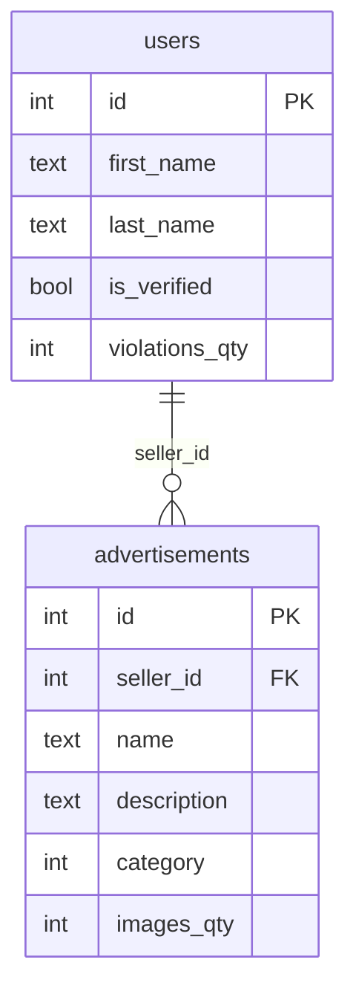

# Сервис модерации объявлений

Python 3.11+. Ответ `true` означает наличие нарушения, `false` — отсутствие.
Подтверждённый продавец всегда проходит проверку. Для остальных требуется хотя бы одно изображение.

## Установка и запуск

### Windows (PowerShell)

```powershell
python -m venv .venv
.\.venv\Scripts\Activate.ps1
python -m pip install -r requirements-dev.txt
docker compose up -d --wait
pgmigrate -d db -t latest migrate
fastapi dev
```

### macOS (Terminal)

```bash
python3 -m venv .venv
source .venv/bin/activate
python -m pip install -r requirements-dev.txt
docker compose up -d --wait
pgmigrate -d db -t latest migrate
fastapi dev
```

Для запуска без тестов достаточно `requirements.txt`.
Документация: http://127.0.0.1:8000/docs

PostgreSQL 16 работает на `localhost:5435`, база `hw`, пользователь и пароль `postgres`.
Docker Desktop должен быть запущен. Миграции находятся в `db/migrations`,
конфигурация pgmigrate — в `db/migrations.yml`. Команды выполняются из корня проекта.
Повторный запуск миграции безопасен: pgmigrate применяет только новые версии.
Для другого подключения можно задать `DATABASE_URL` для сервиса и параметр
`pgmigrate -c 'dbname=... user=... host=... port=... password=...' -d db -t latest migrate`.

## API

`POST /predict`, тело JSON (все поля обязательны):

```json
{
  "seller_id": 1,
  "is_verified_seller": false,
  "item_id": 2,
  "name": "Велосипед",
  "description": "В хорошем состоянии",
  "category": 3,
  "images_qty": 0
}
```

Ответ: HTTP 200, JSON `true`.
Идентификаторы и категория — положительные целые; количество изображений — неотрицательное целое.
Название и описание не могут быть пустыми или состоять из пробелов.
Типы проверяются строго, дополнительные поля запрещены.
Неверные данные (включая некорректный JSON) возвращают 400, внутренняя ошибка — 500 без раскрытия деталей.
`GET /` возвращает приветствие из задания.

`POST /simple_predict` принимает только идентификатор объявления в JSON:

```json
{"item_id": 1}
```

`item_id` — строго целое число от 1 до 2147483647 (диапазон PostgreSQL INTEGER).
Ответ — HTTP 200 с JSON `true` или `false`, как у `/predict`.
Несуществующее объявление возвращает 404 с `{"detail": "Advertisement not found"}`.
Отсутствующее поле, неверный тип, некорректный JSON и лишние поля возвращают 400;
ошибка БД или сервиса — 500 без раскрытия деталей.

## Схема БД



Идентификаторы генерирует PostgreSQL. Внешний ключ запрещает объявления без продавца
и удаление пользователя с объявлениями. Числовые ограничения и непустые строки
проверяются также на уровне БД. Для `seller_id` создан индекс.
`violations_qty` хранится для дальнейшего развития сервиса; текущее правило
предсказания использует статус продавца и количество изображений.

## Архитектура и тесты

`routers/` принимает HTTP-запросы, `services/` применяет бизнес-правило,
`repositories/users.py` создаёт пользователей, `repositories/advertisements.py`
создаёт объявления и получает данные для предсказания одним запросом с `JOIN users`.
Методы `create` принимают модели `UserCreate` и `AdvertisementCreate` из `schemas.py`
и возвращают сгенерированный ID. Репозитории принимают соединение asyncpg;
репозиторий объявлений также принимает пул соединений приложения.
`repositories/moderation.py` предоставляет настройку минимального числа изображений.
Пул открывает соединения по запросу и закрывается при остановке приложения.

```powershell
python -m pytest -q
pytest -q
# После запуска PostgreSQL и применения миграции:
python -m pytest tests --run-db -q
```

Тесты покрывают все сочетания проверки продавца и наличия изображений, обязательность полей,
типы, границы допустимых значений и ошибки сервиса и репозитория.
В тестах валидации проверяется также `loc` ошибки.
По умолчанию тесты PostgreSQL пропускаются; `--run-db` включает их и требует доступной БД.
Без явного пути pytest собирает тесты сервиса из `tests`;
Они проверяют создание записей, внешний ключ, ограничения и `/simple_predict` с реальными данными.
Фикстуры откатывают записи транзакцией после каждого теста, поэтому повторный запуск безопасен.
Для отдельной тестовой БД можно задать `TEST_DATABASE_URL` и предварительно применить к ней миграции.
